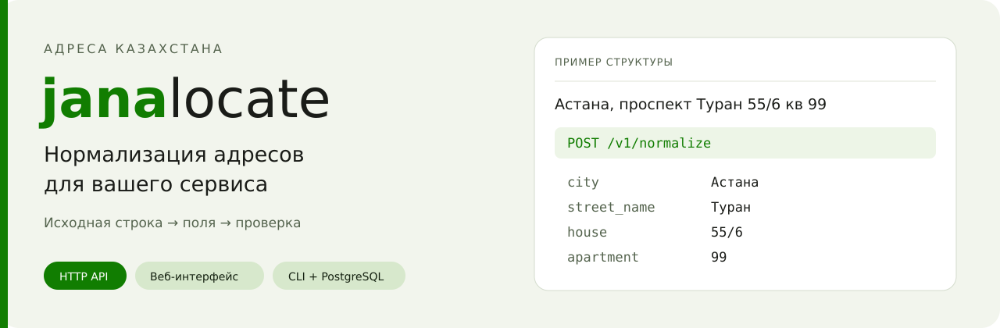
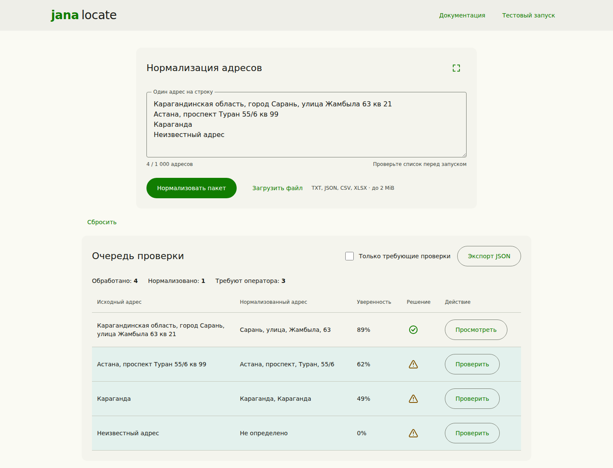

<p align="center">
  
</p>

<p align="center">
  <a href="https://github.com/lukivan8/jana-locate/actions/workflows/ci.yml"></a>
  <a href="https://github.com/lukivan8/jana-locate/actions/workflows/docs.yml"></a>
  <a href="LICENSE"></a>
  
</p>

# Jana Locate

**Превратите адресную строку в структурированные поля и подключите нормализацию к своему сервису по HTTP.** Jana Locate разбирает адреса Казахстана, сохраняет исходный ввод, показывает неизвестные поля и неоднозначности. Для проверки результатов есть веб-интерфейс, для файлов и PostgreSQL — локальный CLI.

[Быстрый запуск](#быстрый-запуск) · [Подключение API](docs/integration.md) · [Примеры кода](examples/http/README.md) · [Документация](docs/README.md) · [Сообщить об ошибке](https://github.com/lukivan8/jana-locate/issues/new/choose)

## Что можно сделать

| Задача | Как использовать Jana Locate |
| --- | --- |
| Нормализовать адрес при создании заказа | Вызвать `POST /v1/normalize` из своего backend |
| Обработать накопленные адреса | Отправлять пакеты до 1000 записей, сохраняя ID и порядок |
| Проверить спорные результаты | Открыть веб-интерфейс, исправить поля и экспортировать JSON |
| Обработать колонку PostgreSQL | Запустить локальный CLI: снимок → нормализация → проверка → явная публикация |
| Работать с файлами без БД | Передать текстовый или JSON-файл в CLI |
| Развернуть в закрытой сети | Заранее собрать образы; при работе загрузка моделей и внешние API не нужны |

Нормализация выделяет область, населённый пункт, район, жилой массив, улицу, дом и детали доставки. Например, из строки `Астана, проспект Туран 55/6 кв 99` извлекаются компоненты адреса; неизвестные значения остаются `null`. Конкретный результат зависит от режима парсера и снимка справочников.

## Быстрый запуск

Нужны **Git, Docker Engine и Docker Compose v2**. Первая сборка использует интернет для зависимостей и моделей libpostal, занимает время и несколько ГБ диска. Готовые образы GHCR пока не опубликованы: команды ниже собирают приложение из исходников.

### Только API — для подключения своего сервиса

```sh
git clone https://github.com/lukivan8/jana-locate.git
cd jana-locate
cp .env.example .env
docker compose up --build --wait backend
curl --fail-with-body http://localhost:8080/readyz
```

API доступен на `http://localhost:8080`. Откройте [руководство подключения](docs/integration.md) или сразу отправьте запрос:

```sh
curl --fail-with-body http://localhost:8080/v1/normalize \
  -H 'Content-Type: application/json' \
  -d '{"records":[{"id":"order-1","raw_address":"Астана, проспект Туран 55/6 кв 99"}]}'
```

Ответ — объект `{"results":[...]}` с одной записью на каждый входной адрес. `id` и `raw_address` сохраняются, выделенные поля находятся непосредственно в каждой записи результата. [Полный сохранённый ответ резервного режима](examples/http/response.fallback.json) и [смысл всех полей](backend/docs/consumer-guide.md).

### API вместе с интерфейсом проверки

```sh
docker compose up --build --wait
```

| Адрес | Назначение |
| --- | --- |
| `http://localhost:3000` | Загрузка, проверка, исправление и экспорт адресов |
| `http://localhost:3000/api` | Документация API в приложении |
| `http://localhost:8080/readyz` | Проверка готовности API |
| `http://localhost:8080/openapi.json` | Машиночитаемый контракт OpenAPI |

По умолчанию порты открыты только на этой машине. [Другие порты, CORS и эксплуатация](docs/deployment.md) · [Запуск без Docker для разработки](docs/quickstart.md).

## Подключение к своему сервису

Jana Locate — отдельный HTTP-сервис. Ваше приложение отправляет адреса и получает JSON; ему не нужны Go, Node.js, доступ к исходникам или прямой доступ к справочнику.

```text
Ваш сервис ── POST /v1/normalize ──► Jana Locate
           ◄── поля, статус, предупреждения ──
```

- Передавайте ID строками, особенно если они превышают безопасный диапазон JavaScript.
- Сохраняйте исходный адрес вместе с результатом; `null` означает, что поле не определено.
- Направляйте `needs_review` и `unmatched` на проверку по правилам вашего продукта.
- `matched` означает полноту основных полей без выявленной неоднозначности. Это не подтверждение существования дома или географической позиции.
- `confidence` — эвристическая оценка для приоритизации проверки, а не измеренная вероятность правильного ответа.

**[Руководство подключения →](docs/integration.md)** · [JavaScript](examples/http/normalize.mjs) · [Python](examples/http/normalize.py) · [Go](examples/http/go/main.go) · [OpenAPI](backend/api/openapi.json)

## Проверка результатов в браузере



*Скриншот актуального приложения на синтетических адресах. Резервный режим без native libpostal явно показывает предупреждения.*

1. Вставьте строки или загрузите файл.
2. Выполните нормализацию и откройте требующие проверки записи.
3. Проверьте предупреждения, исправьте поля; при омонимах выберите населённый пункт явно.
4. Сохраните исправления и экспортируйте результат.

Пакет хранится как задание: его можно открыть по ссылке и продолжить после обновления страницы. Серверные задания хранятся до 7 дней после изменения; лимит — 50 заданий / 64 MiB. [Работа с интерфейсом](docs/web.md) · [API заданий](backend/docs/jobs.md).

## Локальная работа с файлами и PostgreSQL

```sh
./cli/jana up
./cli/jana connect
./cli/jana normalize
```

CLI поднимает API и встроенный сайт проверки; PostgreSQL пользователь подключает отдельно. Исходная таблица остаётся доступной только для чтения. По явной команде готовые результаты публикуются в отдельную связанную таблицу. Пароль базы не передаётся нормализатору. Адресные строки и временные позиционные ID отправляются на выбранный API.

Файловый режим не требует подключения к базе. Прогресс и правки хранятся в локальном SQLite-журнале. **[Руководство CLI →](cli/README.md)**

## Что важно знать перед внедрением

- **География — Казахстан.** Язык и письменность ввода не выбирают другую страну.
- **Геокодирование не входит в нормализацию.** Совместимые поля `coordinates`, `catalog_id`, `catalog_revision` у новых результатов равны `null`.
- **Покрытие справочников частичное.** Включены 66 339 сущностей КАТО/OSM и 1 078 711 адресных свидетельств без координат. Это не гарантия наличия каждого адреса страны. [Источники и покрытие](backend/docs/reference.md).
- **Неоднозначность сохраняется.** Одинаковое название города и села само по себе не позволяет выбрать одну сущность.
- **Точность на независимых реальных данных пока не заявляется.** Встроенные примеры и разметка синтетические.
- **У API нет встроенной авторизации.** Для доступа из внешней сети нужны TLS, аутентификация и ограничения на вашем шлюзе. [Развёртывание](docs/deployment.md).
- **Офлайн относится к runtime.** Зависимости и модели подготавливаются при сборке; перенос образов описан в документации.

## Устройство проекта

| Каталог | Ответственность |
| --- | --- |
| [`backend/`](backend/README.md) | Независимый Go API: libpostal, правила, КАТО/OSM, задания и SDK |
| [`frontend/`](frontend/README.md) | Независимое веб-приложение; обращается к внешнему API по HTTP |
| [`cli/`](cli/README.md) | Локальный потребитель API, PostgreSQL/файлы, журнал и встроенный интерфейс |
| [`docs/`](docs/README.md) | Подключение, запуск, эксплуатация и архитектура |
| [`examples/http/`](examples/http/README.md) | Запускаемые примеры интеграции |

Jana Locate — основной публичный репозиторий. Историческое имя Go-модуля backend `github.com/lukivan8/jana-address` сохранено для совместимости; отдельный репозиторий не нужен для подключения по HTTP. [Архитектура и совместимость](docs/architecture.md).

## Разработка и участие

```sh
make reference      # подготовить SQLite из включённого публичного снимка
make check          # Go race/vet, frontend build/typecheck, контракты и CLI
make generate       # обновить DTO и принятые снимки OpenAPI
make smoke          # изолированный Docker-сценарий и персистентность
make cli-smoke      # CLI, PostgreSQL и публикация
make offline-smoke  # подготовленные образы без внешней сети
```

[Как внести изменение](CONTRIBUTING.md) · [Правила общения](CODE_OF_CONDUCT.md) · [Сообщить об уязвимости](SECURITY.md) · [План развития](docs/roadmap.md)

## Лицензия и данные

Исходный код и документация проекта — [MIT](LICENSE), © 2026 lukivan8. Сторонние библиотеки, модели и данные распространяются на собственных условиях; MIT не заменяет их лицензии. OSM: © OpenStreetMap contributors, [ODbL 1.0](https://www.openstreetmap.org/copyright). [Источники и атрибуция](THIRD_PARTY_NOTICES.md).
